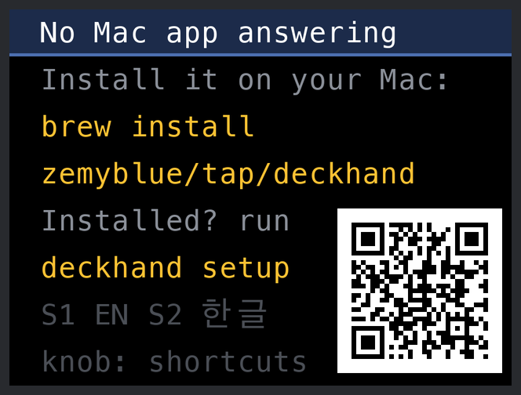
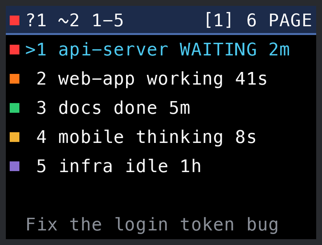
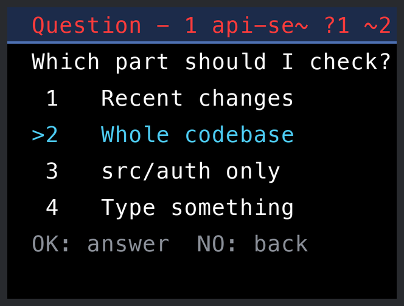

# Deckhand Guide

**English** · [한국어](ko/README.md)

Deckhand is a USB keypad for picking between several Claude Code sessions running in cmux, answering their questions, and giving instructions by voice.


## Contents

1. [What you need](#1-what-you-need)
2. [Install](#2-install)
3. [First connection](#3-first-connection)
4. [Keys and knob](#4-keys-and-knob)
5. [Screen](#5-screen)
6. [LED colours](#6-led-colours)
7. [Answering Claude's questions](#7-answering-claudes-questions)
8. [F1 to F5](#8-f1-to-f5)
9. [Menu bar](#9-menu-bar)
10. [Without the Mac app (shortcut mode)](#10-without-the-mac-app-shortcut-mode)
11. [Updating](#11-updating)
12. [Turning it off and removing it](#12-turning-it-off-and-removing-it)
13. [Troubleshooting](#13-troubleshooting)
14. [Support](#14-support)

## 1. What you need

- A Mac running macOS
- [Homebrew](https://brew.sh)
- cmux, with Claude Code running inside it
- A USB-C cable that carries data (a charge-only cable does not work)

## 2. Install

Run in a terminal:

```sh
brew install zemyblue/tap/deckhand
deckhand doctor     # checks the install
deckhand setup      # start at login
```

- `deckhand setup` shows what it will change and asks first. It changes two things: it switches cmux's access mode to `automation` (one line in `~/.config/cmux/cmux.json`) and adds a login item.
- To undo it, run `deckhand uninstall`. Removing everything is in [section 12](#12-turning-it-off-and-removing-it).
- To look around without a keypad, run `deckhand simulate --web --demo`. It uses made-up sessions and does not touch cmux.

## 3. First connection

Plug the keypad in over USB.

- **If the Mac app does not answer**, the keypad shows an install guide and a QR code after 10 seconds. On that screen **S1 is English and S2 is Korean**. Install as in section 2; a few seconds after `deckhand setup` finishes, the screen changes to the session list.
- **If the Mac app is running**, the session list appears right away.



- `FW^` at the right of the title bar means the keypad's firmware is older than the Mac app. In the menu bar, open the deckhand icon and choose **키패드 → 키패드 펌웨어 올리기** (Keypad → Update keypad firmware). The keypad restarts once and it is done.
- If macOS opens "Keyboard Setup Assistant" the first time, you can close it.

The Mac app's menus and messages are in Korean for now; this guide gives the Korean label with its meaning.

## 4. Keys and knob


| Input | Short press | Long press (0.6 s or more) |
|---|---|---|
| Session keys S1 to S5 | Go to the session on the same line of the screen | Interrupt that session (Esc) |
| Approve (✓) | "Yes" to Claude's plan or permission request. On the answer screen: pick the choice under the cursor. With nothing to answer: take the next prompt Claude suggests into the input box | "Always allow" |
| Reject (✕) | Step out: answer screen → the screen before it, waiting view → full list. With nowhere left to step out: Esc to the session. It never changes the knob mode | Ctrl+C. On the answer screen: decline that question or request |
| Voice (microphone) | Turns Claude Code's voice input (`/voice`) on and off. Hold-to-talk or press-to-toggle follows Claude's setting | none |
| Enter (↵) | Enter to the selected session (send the prompt you wrote) | Shift+Enter (new line) |
| F1 to F5 | The action you set ([section 8](#8-f1-to-f5)) | The long-press action you set |
| Turn the knob | Page mode: next / previous five sessions. Text scroll mode: scroll the selected session's conversation | |
| Press the knob | Page mode ↔ text scroll mode | Page mode: show only the sessions that need an answer. Text scroll mode: jump to the bottom |

The session keys carry no numbers: turning the knob changes which sessions they point at (1 to 5, 6 to 10, and so on). The left key is the first line of the screen.

## 5. Screen

**Session list** (the default)



- Title bar: totals over all sessions (`?2` = two sessions need an answer, `~3` = three are working), the range shown (`1-5`), page tabs, and the knob mode (`PAGE` or `SCROLL`).
- Five lines below: session number, name, state, and how long it has been in that state. The selected session is marked with `>`.
- Bottom: a summary of the selected session's last request.

**Waiting view**: a long press of the knob in page mode shows only the sessions that need an answer, longest waiting first. A long press again, or a press of the knob, returns to the full list.

**Text scroll mode**: press the knob to show the selected session on its own; turning the knob scrolls its conversation in cmux. Press the knob again to go back to the page mode. The reject key does not leave this mode (it sends Esc to that session).

**Answer screen**: appears by itself when Claude asks you to choose ([section 7](#7-answering-claudes-questions)).

## 6. LED colours

The five LEDs above the session keys show the state of the five sessions on the screen.

| Colour | State | Meaning |
|---|---|---|
| Off | none | No session at that number |
| Dim white | no claude | A terminal without Claude |
| Dim purple | idle | Claude is waiting for input |
| Amber, breathing slowly | thinking | Thinking about a request |
| Orange, breathing slowly | working | Running a tool |
| **Red, blinking** | **WAITING** | **Needs your answer (question, plan approval, permission request)** |
| Green | done | Finished, and you have not looked yet |
| Magenta | error | An error |

- All LEDs breathing amber: the Mac app is not connected.
- While the install guide is on the screen, a soft rainbow drifts slowly.
- After 10 minutes without input the LEDs and the screen go dark. Any key wakes it; that first press does nothing else.

## 7. Answering Claude's questions

When Claude asks a question, wants a plan approved, or asks for permission, that session's LED blinks red. Press its session key and the screen becomes the answer screen.



| Input | What it does |
|---|---|
| Turn the knob | Move the cursor between choices |
| Approve, or press the knob | Pick the choice under the cursor. If it is the only question and takes one choice, it is sent at once |
| Enter (↵) | Go to the next question. After the last one comes a review page: submit or cancel |
| Reject short, or knob long | Leave without answering. The question stays |
| Reject long | Decline that question or request |

- You can answer without going to the session; you may be looking at another window.
- If you answer in the terminal instead, the keypad's answer screen closes by itself within a few seconds.
- Picking the last choice, "Type something", lets you write the answer by voice or keyboard and send it with Enter.

## 8. F1 to F5

The defaults:

| Key | Action |
|---|---|
| F1 | Back to the session you were on before |
| F2 | Change Claude Code's permission mode (Shift+Tab) |
| F3 | Open a new session |
| F4 | Bring the last prompt back into the input box (↑) |
| F5 | Delete: a press = one character, held = keeps deleting |

To change them, open **환경설정…** (Settings) from the deckhand icon in the menu bar.

- **Send keys**: tick ⌃ Control, ⌥ Option, ⇧ Shift or ⌘ Command, pick a key and press **넣기** (Add) to get a combination such as `cmd+shift+k`, shown below as ⌘⇧K. Add several to send them one after another. F1 to F12, and digits or symbols with a modifier, are not taken by cmux, so they are not saved.
- **Mac key (volume, play, brightness)**: volume up/down, mute, play/pause, next/previous track, screen brighter/dimmer. The keypad presses it like the Mac keyboard's own key (from 0.2.0b2).
- If saving fails, the top of the page names the key to fix and scrolls to it.

## 9. Menu bar

While the Mac app runs, a deckhand icon sits in the menu bar.

- Status: keypad connection, cmux connection, how many sessions need an answer
- **키패드** (Keypad): firmware version, update keypad firmware, self-test, time until sleep, LED brightness, LED breathing effect
- **Mac 앱** (Mac app): version, check for a new version, update
- **환경설정…** (Settings): F1 to F5 and the voice mode
- **deckhand 다시 시작** (Restart deckhand)
- **deckhand 끝내기** (Quit deckhand): off for now; it starts again at the next login ([section 12](#12-turning-it-off-and-removing-it))

## 10. Without the Mac app (shortcut mode)

When the Mac app does not answer, the keypad acts as a USB keyboard and types shortcuts into whatever window is in front. The screen shows `SHORTCUT MODE`. It cannot know the session states.

| Key | Sends |
|---|---|
| S1 to S5 | ⌘1 to ⌘5 (cmux workspaces 1 to 5) |
| Turn the knob | ⌃⌘] / ⌃⌘[ (next / previous workspace) |
| Approve, Enter | Enter |
| Reject | Esc |
| F2 | Shift+Tab |
| F4 | ↑ (previous prompt) |
| F5 | Backspace |
| Voice | Space, while held |

Pressing the knob switches between the shortcut list and the install guide.

## 11. Updating

```sh
brew upgrade zemyblue/tap/deckhand
brew services restart zemyblue/tap/deckhand
```

Then, if the keypad's title bar shows `FW^`, choose **키패드 → 키패드 펌웨어 올리기** in the menu bar, or run `deckhand flash` in a terminal. There is no need to unplug the cable or open the case.

To see which firmware the keypad has, long-press the knob in page mode (the waiting view): the version is on the screen.

**From 0.2.0b1** the keypad has new firmware (it starts and updates faster). Update the Mac app first, then the keypad: an older app does not understand the new firmware's F5.

- On a computer that blocks USB drives (a work computer, say) the firmware cannot be updated, though the keypad still works. Update it on another computer and take it back: the firmware stays in the keypad.
- If the keypad does not show up on USB: plug it in while holding **S1 + S5 + ENTER**. When an `RP2350` drive appears on the Mac, run `deckhand flash`.

## 12. Turning it off and removing it

**Turning it off for a while**

Open the deckhand icon in the menu bar and choose **deckhand 끝내기** (Quit deckhand). Confirm with "끝내기" (Quit).

- It starts again the next time you log in.
- To start it again now, run `deckhand start` in a terminal.

While it is off, the keypad works in [shortcut mode](#10-without-the-mac-app-shortcut-mode).

**Removing it completely**

```sh
deckhand uninstall                       # removes the login item and the one cmux setting that setup changed
brew uninstall zemyblue/tap/deckhand     # deletes the Mac app
brew untap zemyblue/tap                  # (optional) drops this tap from Homebrew
```

- Keep this order. Once the app is deleted, `deckhand uninstall` can no longer run.
- Two things stay behind; delete them yourself if you do not need them: settings in `~/.config/deckhand/`, and the log at `$(brew --prefix)/var/log/deckhand.log`.
- Nothing needs removing from the keypad. Without the app it shows the install guide and works in shortcut mode.

## 13. Troubleshooting

| What you see | What to try |
|---|---|
| All LEDs breathe amber and the keys do nothing | The Mac app is not connected. Run `brew services restart zemyblue/tap/deckhand`. If that does not help, unplug and replug both ends of the cable, then try another cable and another USB port |
| The install guide shows although the app is installed | The Mac app is not running. If you quit it from the menu, run `deckhand start`; if it was never set up, run `deckhand setup` |
| The screen says `waiting for cmux` | Start cmux |
| `FW^` in the title bar | The keypad's firmware is older. Update it from the menu bar |
| `APP^` in the title bar | The Mac app is older. Update as in [section 11](#11-updating) |
| A session is missing from the list | Run `deckhand doctor` to check the cmux connection |
| One key or LED does not work | Menu bar **키패드 → 자가 진단 시작** (Keypad → Start self-test), or hold S1 and S5 together for 2 seconds. It checks every key, the knob, the LEDs and the screen. The same two keys leave it |
| The voice key does nothing | First check that `/voice` works in Claude Code |
| Something not listed here | Run `deckhand report` and attach the file it makes to [Support](#14-support) |

## 14. Support

Please report problems and suggestions in this repository's [Issues](https://github.com/zemyblue/deckhand-guide/issues). Include the output of `deckhand --version` and what the keypad's screen shows.

`deckhand report` writes a file to attach to your report, on the Desktop, named `deckhand-report-…`.

- It holds the versions, the `deckhand doctor` checks and the last 400 lines of the service log.
- Session names, typed text, the home folder and the account name are hidden.
- Nothing is sent anywhere. Open the file, read it, and attach it yourself.
