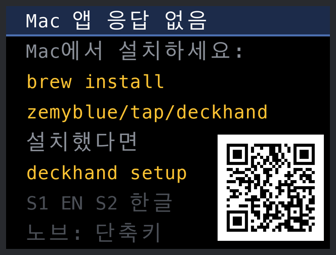
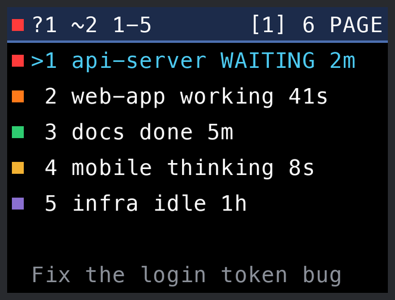
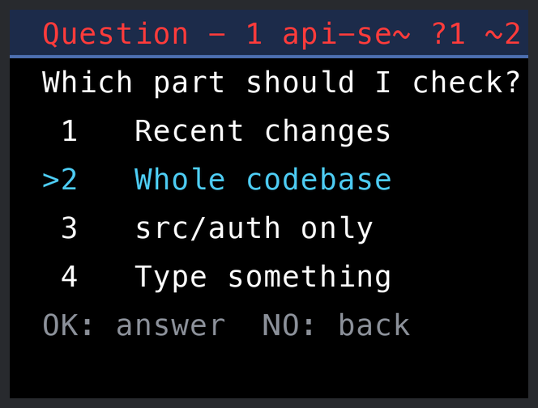

# Deckhand 사용 설명서

[English](../README.md) · **한국어**

Deckhand는 cmux 안에서 돌아가는 여러 Claude Code 세션을 고르고, 질문에 답하고, 음성으로 지시하는 USB 키패드입니다.


## 목차

1. [필요한 것](#1-필요한-것)
2. [설치](#2-설치)
3. [처음 연결할 때](#3-처음-연결할-때)
4. [키와 노브](#4-키와-노브)
5. [화면](#5-화면)
6. [LED 색](#6-led-색)
7. [Claude의 질문에 답하기](#7-claude의-질문에-답하기)
8. [F1~F5 키](#8-f1f5-키)
9. [메뉴 막대](#9-메뉴-막대)
10. [Mac 앱 없이 쓰기 (단축키 모드)](#10-mac-앱-없이-쓰기-단축키-모드)
11. [업데이트](#11-업데이트)
12. [끄기와 제거](#12-끄기와-제거)
13. [문제 해결](#13-문제-해결)
14. [문의](#14-문의)

## 1. 필요한 것

- macOS가 설치된 Mac
- [Homebrew](https://brew.sh)
- cmux와 그 안에서 실행하는 Claude Code
- 데이터가 되는 USB-C 케이블 (충전 전용 케이블은 안 됩니다)

## 2. 설치

터미널에서 실행합니다.

```sh
brew install zemyblue/tap/deckhand
deckhand doctor     # 설치 점검
deckhand setup      # 로그인할 때 자동으로 켜기
```

- `deckhand setup`은 무엇을 바꾸는지 먼저 보여 주고 동의를 받습니다. 바꾸는 것은 두 가지입니다: cmux의 접근 방식을 `automation`으로 바꾸고(`~/.config/cmux/cmux.json`의 한 줄), 로그인 항목을 등록합니다.
- 되돌리려면 `deckhand uninstall`을 실행합니다. 완전히 제거하는 방법은 [12번](#12-끄기와-제거)에 있습니다.
- 키패드 없이 미리 둘러보려면 `deckhand simulate --web --demo`를 실행합니다. 가상 세션으로 동작하고 cmux를 건드리지 않습니다.

## 3. 처음 연결할 때

키패드를 USB로 꽂습니다.

- **Mac 앱이 응답하지 않으면** 10초 뒤 키패드 화면에 설치 안내와 QR 코드가 뜹니다. 이 화면에서 **S1은 영어, S2는 한국어**로 바꿉니다. 위 2번대로 설치하고 `deckhand setup`을 마치면 몇 초 안에 세션 목록으로 바뀝니다.
- **Mac 앱이 켜져 있으면** 바로 세션 목록이 뜹니다.



- 화면 제목 줄 오른쪽에 `FW^`가 보이면 키패드 펌웨어가 Mac 앱보다 오래된 것입니다. 메뉴 막대의 deckhand 아이콘에서 **키패드 → 키패드 펌웨어 올리기**를 누릅니다. 키패드가 한 번 재시작하면 끝납니다.
- 처음 꽂을 때 macOS가 "키보드 설정 지원" 창을 띄우면 닫아도 됩니다.

## 4. 키와 노브


| 입력 | 짧게 누름 | 길게 누름 (0.6초 이상) |
|---|---|---|
| 세션 키 S1~S5 | 화면의 같은 줄에 있는 세션으로 이동 | 그 세션의 작업 중단 (Esc) |
| 승인 (✓) | Claude의 플랜·권한 요청에 "예". 응답 화면에서는 커서가 있는 선택지를 고름. 답할 것이 없으면 Claude가 제안한 다음 프롬프트를 입력칸에 받음 | "항상 허용" |
| 거절 (✕) | 나가기: 응답 화면 → 세션 목록, 글 스크롤 → 페이지. 더 나갈 곳이 없으면 세션에 Esc | Ctrl+C. 응답 화면에서는 그 질문·요청을 거절 |
| 음성 (마이크) | Claude Code의 음성 입력(`/voice`)을 켜고 끔. 누르고 있는 방식과 한 번씩 누르는 방식 중 Claude 설정을 따름 | 없음 |
| 확인 (↵) | 선택한 세션에 Enter (쓴 프롬프트 보내기) | Shift+Enter (줄바꿈) |
| F1~F5 | 지정한 동작 ([8번](#8-f1f5-키)) | 지정한 길게 동작 |
| 노브 돌리기 | 페이지 모드: 다음/이전 5개 세션. 글 스크롤 모드: 선택한 세션의 대화를 위아래로 | |
| 노브 누르기 | 페이지 모드 ↔ 글 스크롤 모드 | 페이지 모드: 응답이 필요한 세션만 모아 보기. 글 스크롤 모드: 맨 아래로 |

세션 키에는 숫자가 없습니다. 노브로 페이지를 넘기면 1~5, 6~10처럼 가리키는 세션이 바뀌기 때문입니다. 왼쪽 키가 화면의 첫째 줄입니다.

## 5. 화면

**세션 목록** (기본)



- 제목 줄: 전체 세션의 합계(`?2` = 응답이 필요한 세션 2개, `~3` = 작업 중 3개), 지금 보는 범위(`1-5`), 페이지 표시, 노브 모드(`PAGE` 또는 `SCROLL`).
- 아래 5줄: 세션 번호, 이름, 상태, 그 상태가 된 뒤 지난 시간. 선택한 세션은 `>`로 표시됩니다.
- 맨 아래: 선택한 세션의 마지막 요청 요약.

**응답 모아 보기**: 페이지 모드에서 노브를 길게 누르면 응답이 필요한 세션만 오래 기다린 순서로 보입니다. 다시 길게 누르거나 노브를 누르면 전체 목록으로 돌아갑니다.

**글 스크롤 모드**: 노브를 누르면 선택한 세션 하나를 크게 보여 주고, 노브를 돌려 cmux의 대화 기록을 위아래로 움직입니다.

**응답 화면**: Claude가 선택지를 물으면 자동으로 뜹니다 ([7번](#7-claude의-질문에-답하기)).

## 6. LED 색

세션 키 위의 LED 5개가 화면에 보이는 세션 5개의 상태입니다.

| 색 | 상태 | 뜻 |
|---|---|---|
| 꺼짐 | 없음 | 그 번호에 세션이 없음 |
| 어두운 흰색 | no claude | 터미널은 있지만 Claude가 없음 |
| 어두운 보라 | idle | Claude가 입력을 기다림 |
| 호박색, 천천히 숨쉬기 | thinking | 요청을 받고 생각 중 |
| 주황, 천천히 숨쉬기 | working | 도구를 실행 중 |
| **빨강, 깜빡임** | **WAITING** | **사람의 답이 필요함 (질문, 플랜 승인, 권한 요청)** |
| 초록 | done | 답을 마쳤고 아직 보지 않음 |
| 자홍 | error | 오류 |

- 전체가 호박색으로 숨쉬면 Mac 앱과 연결이 끊긴 것입니다.
- 설치 안내 화면이 떠 있는 동안에는 옅은 무지개가 천천히 흐릅니다.
- 10분 동안 아무 입력이 없으면 LED와 화면이 꺼집니다. 아무 키나 누르면 다시 켜지고, 그 첫 누름은 다른 동작을 하지 않습니다.

## 7. Claude의 질문에 답하기

Claude가 질문, 플랜 승인, 권한 요청을 하면 그 세션의 LED가 빨갛게 깜빡입니다. 그 세션 키를 누르면 화면이 응답 화면으로 바뀝니다.



| 입력 | 동작 |
|---|---|
| 노브 돌리기 | 선택지 사이로 커서 이동 |
| 승인 또는 노브 누르기 | 커서가 있는 선택지를 고름. 선택지 하나만 고르는 질문이 하나뿐이면 바로 답으로 보냄 |
| 확인 (↵) | 다음 질문으로. 마지막에는 "보내기 / 취소"를 고르는 확인 쪽이 나옴 |
| 거절 짧게, 노브 길게 | 답하지 않고 세션 목록으로 나감. 질문은 남아 있음 |
| 거절 길게 | 그 질문·요청을 거절 |

- 세션으로 이동하지 않아도 답할 수 있습니다. 다른 창을 보고 있어도 됩니다.
- 터미널에서 직접 답하면 키패드의 응답 화면은 몇 초 안에 스스로 닫힙니다.
- 선택지 끝의 "직접 입력…"을 고르면 음성이나 키보드로 답을 쓰고 확인 키로 보냅니다.

## 8. F1~F5 키

기본 동작은 이렇습니다.

| 키 | 동작 |
|---|---|
| F1 | 직전에 보던 세션으로 돌아가기 |
| F2 | Claude Code 권한 모드 바꾸기 (Shift+Tab) |
| F3 | 새 세션 열기 |
| F4 | 방금 보낸 프롬프트를 입력칸에 다시 꺼내기 (↑) |
| F5 | 지우기: 짧게 = 한 글자, 길게 = 한 단어 |

바꾸려면 메뉴 막대의 deckhand 아이콘에서 **환경설정…**을 엽니다.

## 9. 메뉴 막대

Mac 앱이 켜져 있으면 메뉴 막대에 deckhand 아이콘이 있습니다.

- 상태: 키패드 연결, cmux 연결, 응답이 필요한 세션 수
- **키패드**: 펌웨어 버전, 키패드 펌웨어 올리기, 자가 진단, 절전까지 걸리는 시간, LED 밝기, LED 호흡 효과
- **Mac 앱**: 버전, 새 버전 확인, 업데이트
- **환경설정…**: F1~F5와 음성 방식
- **deckhand 다시 시작**
- **deckhand 끝내기**: 지금만 끕니다. 다음 로그인 때 다시 켜집니다 ([12번](#12-끄기와-제거))

## 10. Mac 앱 없이 쓰기 (단축키 모드)

Mac 앱이 응답하지 않으면 키패드는 USB 키보드로 동작해, 지금 앞에 있는 창에 단축키를 직접 보냅니다. 화면에 `SHORTCUT MODE`가 뜹니다. 세션 상태는 알 수 없습니다.

| 키 | 보내는 것 |
|---|---|
| S1~S5 | ⌘1~⌘5 (cmux 워크스페이스 1~5) |
| 노브 돌리기 | ⌃⌘] / ⌃⌘[ (다음 / 이전 워크스페이스) |
| 승인, 확인 | Enter |
| 거절 | Esc |
| F2 | Shift+Tab |
| F4 | ↑ (이전 프롬프트) |
| F5 | Backspace |
| 음성 | 누르는 동안 스페이스 |

노브를 누르면 단축키 목록과 설치 안내 화면을 오갑니다.

## 11. 업데이트

```sh
brew upgrade zemyblue/tap/deckhand
brew services restart zemyblue/tap/deckhand
```

그다음 키패드 화면 제목 줄에 `FW^`가 보이면 메뉴 막대의 **키패드 → 키패드 펌웨어 올리기**를 누릅니다. 터미널에서 `deckhand flash`를 실행해도 같습니다. 케이블을 뽑거나 케이스를 열 필요가 없습니다.

## 12. 끄기와 제거

**잠깐 끄기**

메뉴 막대의 deckhand 아이콘에서 **deckhand 끝내기**를 누릅니다. 확인 창에서 "끝내기"를 고르면 꺼집니다.

- 다음에 로그인하면 다시 켜집니다.
- 지금 다시 켜려면 터미널에서 `deckhand start`를 실행합니다.

꺼져 있는 동안 키패드는 [단축키 모드](#10-mac-앱-없이-쓰기-단축키-모드)로 동작합니다.

**완전히 제거하기**

```sh
deckhand uninstall                       # 로그인 항목 해제, setup이 바꾼 cmux 설정 한 줄 되돌리기
brew uninstall zemyblue/tap/deckhand     # Mac 앱 삭제
brew untap zemyblue/tap                  # (선택) 설치 목록에서 이 저장소 빼기
```

- 순서를 지켜 주세요. 앱을 먼저 지우면 `deckhand uninstall`을 실행할 수 없습니다.
- 남는 파일은 두 가지이고, 필요 없으면 직접 지웁니다: 설정 `~/.config/deckhand/`, 기록 `$(brew --prefix)/var/log/deckhand.log`.
- 키패드 자체에는 지울 것이 없습니다. 앱이 없으면 설치 안내 화면과 단축키 모드로 동작합니다.

## 13. 문제 해결

| 증상 | 해 볼 것 |
|---|---|
| LED 전체가 호박색으로 숨쉬고 키가 안 먹음 | Mac 앱과 연결이 끊긴 것입니다. `brew services restart zemyblue/tap/deckhand`를 실행합니다. 그래도 안 되면 케이블을 양쪽 다 뽑았다 꽂고, 다른 케이블과 다른 USB 포트를 써 봅니다 |
| 설치했는데도 설치 안내 화면이 뜸 | Mac 앱이 꺼져 있습니다. 메뉴에서 끝낸 것이라면 `deckhand start`, 아직 설정하지 않았다면 `deckhand setup`을 실행합니다 |
| 화면에 `waiting for cmux`가 보임 | cmux를 실행합니다 |
| 제목 줄에 `FW^` | 키패드 펌웨어가 오래됨. 메뉴 막대에서 펌웨어를 올립니다 |
| 제목 줄에 `APP^` | Mac 앱이 오래됨. [11번](#11-업데이트)대로 업데이트합니다 |
| 세션이 목록에 안 보임 | `deckhand doctor`로 cmux 연결을 점검합니다 |
| 키나 LED 하나가 동작하지 않음 | 메뉴 막대의 **키패드 → 자가 진단 시작**, 또는 S1과 S5를 함께 2초 누릅니다. 키, 노브, LED, 화면을 하나씩 확인합니다. 같은 조합으로 나옵니다 |
| 음성 키가 안 됨 | Claude Code에서 `/voice`가 되는지 먼저 확인합니다 |

## 14. 문의

문제나 제안은 이 저장소의 [Issues](https://github.com/zemyblue/deckhand-guide/issues)에 남겨 주세요. `deckhand --version`의 출력과 키패드 화면에 보이는 내용을 함께 적어 주시면 빨리 확인할 수 있습니다.
